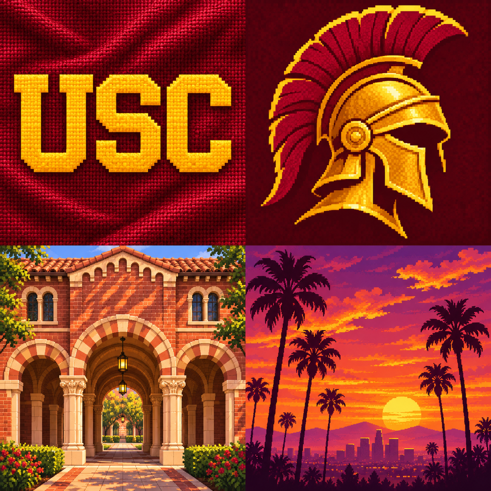
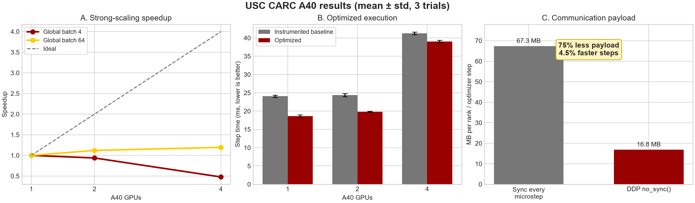
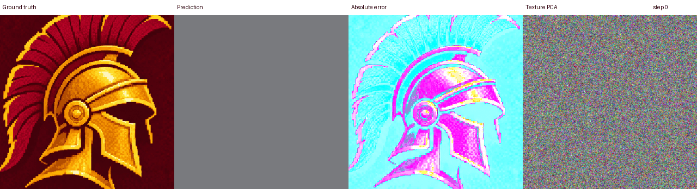
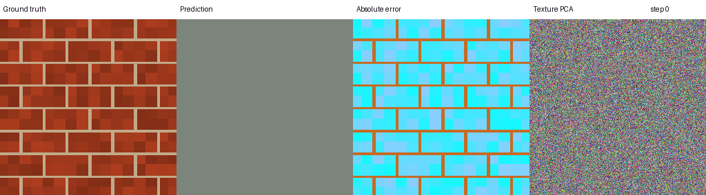

<div align="center">

# Scalable Neural Textures

### When does adding GPUs make neural-texture training faster—and when does it make it slower?

**PyTorch · DDP/NCCL · Slurm · USC CARC A40 · 3-trial measurements · 19 tests**

[Results](#results) · [Visual gallery](#visual-gallery) · [Method](#method) · [Reproduce](#reproduce) · [CARC guide](docs/carc.md)



*Original, unofficial USC-inspired training atlas: lettering, Trojan helmet, campus architecture, and a Southern California sunset.*

</div>

## Project in one minute

A conventional texture stores RGB directly. This project instead learns a
`1024 × 1024 × 16` feature texture and uses a compact CNN to decode sampled
features into RGB:

```text
UV coordinates ──> bilinear sample ──> learned feature image ──> CNN ──> RGB
                         ^                         ^
                         │                         │
              neural texture [1,C,H,W]          mask
```

The feature texture contains **16.8 million trainable values** and produces a
**67.1 MB FP32 gradient per rank**. That makes it a useful controlled workload
for studying distributed training, communication overhead, UV visibility, and
execution optimization.

The central finding is not simply “more GPUs are faster”:

> **Multi-GPU speedup depends on the computation-to-communication ratio.** A
> global batch of 4 became slower with more GPUs; increasing the fixed global
> batch to 64 and synchronizing once per optimizer step produced a measured
> **1.19× speedup on 4 A40 GPUs**.

## Results

<div align="center">

</div>

All reported values are the mean of **three trials on NVIDIA A40 GPUs**. The
4-GPU runs span two CARC nodes. Error bars show one sample standard deviation.

### 1. Workload size determines scaling

| Fixed workload | 1 GPU | 2 GPUs | 4 GPUs | Result |
|---|---:|---:|---:|---|
| Complex texture, global batch 4 | **18.60 ms** | 19.85 ms | 39.04 ms | Communication dominates; 4 GPUs are slower |
| Complex texture, global batch 64 | 314.30 ms | 280.69 ms | **263.17 ms** | 4 GPUs reach **1.19× speedup** |

For global batch 64, throughput increases from **204.74 to 243.39 samples/s**.
This is fixed-workload strong scaling: every GPU count processes the same 64
samples and the same number of optimizer steps.

### 2. Execution optimization improves absolute speed

The optimized path combines mixed precision, fused Adam, channels-last
convolutions, cuDNN autotuning, scheduled visibility analysis, one collective
for scalar metrics, and one end-of-step synchronization.

| GPUs | Instrumented baseline | Optimized | Step-time reduction |
|---:|---:|---:|---:|
| 1 | 24.06 ± 0.32 ms | **18.60 ± 0.36 ms** | **22.7%** |
| 2 | 24.39 ± 0.44 ms | **19.85 ± 0.14 ms** | **18.6%** |
| 4 | 41.26 ± 0.38 ms | **39.04 ± 0.33 ms** | **5.4%** |

### 3. `no_sync()` reduces redundant communication

With four gradient-accumulation microsteps on two GPUs, DDP normally
all-reduces after every microstep. Using `no_sync()` for the first three keeps
the mathematical workload unchanged while communicating only once.

| Mode | Payload / rank / step | Communication time | Step time |
|---|---:|---:|---:|
| Sync every microstep | 67.34 MB | 22.50 ms | 71.89 ms |
| DDP `no_sync()` | **16.83 MB** | **16.44 ms** | **68.65 ms** |

That is **75% less gradient payload**, approximately **27% less measured
communication time**, and **4.5% faster steps**.

Raw aggregate values are committed in
[`results/final_metrics.csv`](results/final_metrics.csv) and
[`results/no_sync_metrics.csv`](results/no_sync_metrics.csv). Rebuild the figure
with:

```bash
python scripts/plot_final_report.py
```

## Visual gallery

Each animation shows **ground truth, prediction, absolute error, and a PCA
projection of the learned feature texture**. The full showcase reaches:

| Showcase | Final PSNR | Validation PSNR |
|---|---:|---:|
| USC-inspired atlas | 37.45 dB | **33.87 dB** |
| Voxel atlas | 34.43 dB | **34.07 dB** |

### USC-inspired neural texture

<div align="center">

</div>

Four equally framed UV regions are available:

- [USC lettering animation](docs/assets/showcase/usc.gif)
- [Trojan helmet animation](docs/assets/showcase/trojan.gif)
- [Campus architecture animation](docs/assets/showcase/campus.gif)
- [Southern California sunset animation](docs/assets/showcase/sunset.gif)

The illustration is original and unofficial; it is not an official USC seal or
licensed athletics asset.

### Original voxel-material atlas

<div align="center">

</div>

- [Brick animation](docs/assets/showcase/brick.gif)
- [Leaves animation](docs/assets/showcase/leaves.gif)
- [Grass and dirt animation](docs/assets/showcase/grass.gif)
- [Stone animation](docs/assets/showcase/stone.gif)

The voxel materials are generated by this repository and do not copy Minecraft
or another commercial game's textures. Each animation uses an exact centered
quadrant crop, and those four canonical crops are included in the training set
so every displayed corner receives gradient coverage.

## Method

### Training system

- Explicit learnable feature atlas sampled with `torch.grid_sample`.
- Compact configurable CNN renderer and masked L1 objective.
- Deterministic synthetic or on-disk RGB/UV/mask datasets.
- DDP/NCCL with fixed-global-batch validation and identical sample ordering.
- Mixed precision, fused Adam, channels-last execution, and `no_sync()`.
- Per-step loss, PSNR, throughput, memory, visibility, and communication logs.
- Checkpoint resume, validation rendering, PCA visualization, and GIF export.

### Experiment matrix

| Config | Purpose | Global batch | Texture | Steps |
|---|---|---:|---:|---:|
| [`scaling.yaml`](configs/scaling.yaml) | Small synthetic strong scaling | 8 | 512²×16 | 500 |
| [`usc_scaling.yaml`](configs/usc_scaling.yaml) | Complex small-workload scaling | 4 | 1024²×16 | 300 |
| [`usc_speed_optimized.yaml`](configs/usc_speed_optimized.yaml) | Execution optimization | 4 | 1024²×16 | 300 |
| [`usc_large_batch_scaling.yaml`](configs/usc_large_batch_scaling.yaml) | Compute-heavy positive scaling | 64 | 1024²×16 | 200 |
| [`accumulation_baseline.yaml`](configs/accumulation_baseline.yaml) / [`optimized.yaml`](configs/optimized.yaml) | Every-microstep sync vs `no_sync()` | 16 | 512²×16 | 500 |

The full measurement contract—including warm-up exclusion, fixed workload,
communication semantics, and required repetitions—is documented in
[`docs/benchmarking.md`](docs/benchmarking.md).

## Reproduce

### Local installation and tests

```bash
python -m venv .venv

# Windows PowerShell
.venv\Scripts\Activate.ps1

# Linux/macOS
source .venv/bin/activate

python -m pip install -e ".[dev]"
pytest
```

Expected result: **19 passed**.

### Local smoke training

```bash
python -m neural_texture.train \
  --config configs/smoke_test.yaml \
  --output-dir outputs/smoke
```

Every run records its resolved config, hardware/software metadata, per-step CSV,
summary JSON, checkpoints, validation images, progress frames, and animation.

### USC CARC

The repository includes module-safe Slurm scripts for 1, 2, and two-node 4-GPU
A40 runs:

```bash
sbatch slurm/train_1gpu_carc.sbatch
sbatch slurm/train_2gpu_carc.sbatch
sbatch slurm/train_4gpu_carc.sbatch
```

For the compute-heavy scaling experiment, export the same config at every GPU
count:

```bash
sbatch --export=ALL,NT_CONFIG=configs/usc_large_batch_scaling.yaml \
  slurm/train_1gpu_carc.sbatch
sbatch --export=ALL,NT_CONFIG=configs/usc_large_batch_scaling.yaml \
  slurm/train_2gpu_carc.sbatch
sbatch --export=ALL,NT_CONFIG=configs/usc_large_batch_scaling.yaml \
  slurm/train_4gpu_carc.sbatch
```

Environment setup, notifications, monitoring, and troubleshooting are in
[`docs/carc.md`](docs/carc.md).

## Repository map

```text
configs/                 Reproducible experiment definitions
docs/                    CARC, benchmarking, and dataset documentation
docs/assets/             README figures and training animations
scripts/                 Dataset, plotting, and target-rendering tools
slurm/                   1/2/4-GPU CARC batch scripts
src/neural_texture/      Dataset, model, DDP trainer, metrics, visualization
tests/                   Shape, sampling, training, DDP, and visibility tests
results/                 Committed aggregate CARC measurements
```

## Scope and limitations

This is a neural-feature-texture training and systems study—not NeRF, novel-view
synthesis, or texture compression. The current renderer does not use camera
direction, normals, or dynamic lighting. The 16-channel FP32 neural texture is
larger than an RGB texture; its purpose here is learned appearance
representation and a communication-heavy distributed workload.

The key systems conclusion is deliberately conditional: **more GPUs help only
when each optimizer step contains enough useful computation to amortize model
synchronization**. The project demonstrates both sides of that boundary with
measured CARC results rather than assuming scaling.

## License

[MIT](LICENSE)
